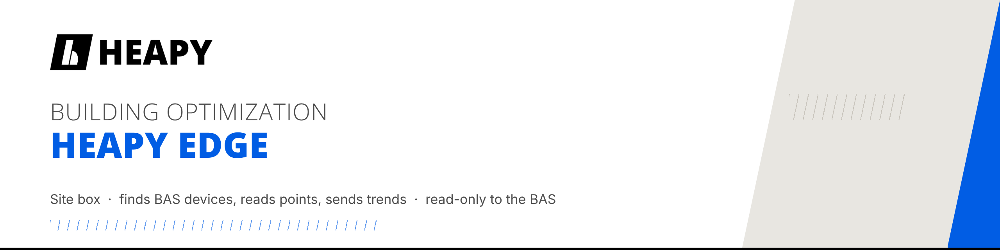

<p align="center"></p>

<p align="center">


</p>

HEAPY Edge is the site box. It finds BAS devices on a client network, reads their points on a schedule, keeps the readings in a local buffer and sends them to HEAPY Trend Tracker over outbound HTTPS. Read-only to the BAS: it never writes to a device.

Plan: `docs/HEAPY Edge - Project Plan.html` (HEAPY Data Collection project).

## Layout

| Folder | What it is |
|---|---|
| `core/` | Node 22.13+ program, no npm packages: settings, driver host, scanner, poll scheduler, SQLite buffer, uploader, pairing/check-in, local setup page |
| `drivers/bacnet-ip/` | BACnet/IP driver (Python 3, BACpypes3, BSD licence). Also reaches MS/TP and other trunks through BACnet routers |
| `drivers/bacnet-mstp/` | BACnet MS/TP straight on an RS-485 trunk: listens first (baud, addresses in use), joins on a free MAC through bacnet-stack's `router-mstp` in a private network inside the box |
| `drivers/modbus/` | Modbus TCP, TCP-to-RS-485 gateways, RTU on a serial port and RTU over TCP. Own framing (no library); register templates, all common types and word orders |
| `drivers/snmp/` | SNMP v1, v2c and v3 (auth + privacy), pysnmp; built-in UPS-MIB template, optional subtree listing |
| `drivers/haystack/` | Project Haystack servers (SkySpark, Niagara nHaystack, …): SCRAM-SHA-256 / basic / no login, JSON v3 and v4 |
| `drivers/obix/` | Niagara stations and other oBIX servers: browses the station, reads points in batches |
| `drivers/common/` | Shared pieces for Python drivers: JSON-lines protocol, rate limiter, HTTPS client with certificate pinning |
| `contracts/` | The fixed contracts: `driver-protocol.json` (core ↔ driver) and `upload-api.json` (box ↔ Trend Tracker) |
| `web/` | Setup page (HEAPY brand) served on port 8770 |
| `sim/` | Simulated sites with fault injection: BACnet/IP (`bacnet_sim.py`), MS/TP trunk on a virtual RS-485 bus (`mstp_site.py`, `rs485_bus.py`), Modbus (`modbus_sim.py`), SNMP (`snmp_sim.py`), Haystack (`haystack_sim.py`), oBIX (`obix_sim.py`) |
| `tests/` | `selftest.js` (unit + every driver against its simulator), `faults*.js` (fault suite per driver), `soak24.js` (24-hour soak with scheduled faults, any driver), `mock-intake.js` (stand-in for the Trend Tracker intake API) |
| `tools/` | `build-bacnet-stack.sh`: builds the MS/TP router from a pinned bacnet-stack release |

## Run

```
pip install -r drivers/bacnet-ip/requirements.txt -r drivers/snmp/requirements.txt
sh tools/build-bacnet-stack.sh           # only for MS/TP
node core/main.js --data ./data          # or HEAPY_EDGE_DATA=/data
```
Open `http://<box>:8770`, set the page password, set the BAS port address under Settings, turn on any other connections (MS/TP, Modbus, SNMP, Haystack, oBIX) under Settings → Other connections, then Connect to HEAPY with a pairing code.

Docker (Pi 5, mini-PC or Linux VM): `docker compose up -d`. GitHub Actions builds the image for arm64 and amd64 on every push to main and publishes it to GitHub Container Registry under the repository's owner (`.github/workflows/image.yml`): `ghcr.io/heapy-bog/heapy-edge` now that the repository is in HEAPY-BOG. `docker-compose.yml` still names the earlier image, `ghcr.io/dys3d/heapy-edge`, and boxes pull from the image it names. Host networking is required so BACnet broadcasts reach the BAS network.

## AI assistants

Each box is an MCP server at `http://<box>:8770/mcp`, so Claude Code, Codex, Claude or ChatGPT can answer questions about its devices, points, live values, trends and health (`core/assist.js`). Sign-in is like Novant's: add the box as a custom connector or MCP server (`claude mcp add --transport http edge http://<box>:8770/mcp`, then `/mcp` to sign in), the assistant opens the box's Allow page, you type the setup page password and click Allow, and the box issues it a revocable token (OAuth 2.1 with PKCE and dynamic client registration). Under Settings → AI assistants the box owner picks Read + confirmed edits, Read only, or Off, and can disconnect any assistant. With edits on, an assistant can propose trend on/off, intervals, labels and notes (or a scan); it must show the proposal and call `apply_changes` with `confirm: true`, an invalid batch is never partly applied, and every change is in the audit log. Nothing an assistant does can write to a BAS device. The box is reachable from the site network (or a VPN into it); reaching every site from claude.ai is what the central Atlas server adds in Phase 2 by re-exposing the same tools behind one public address.

## Test

```
node tests/selftest.js          # needs Linux root for the simulated networks; --unit for unit checks only
node tests/assist_check.js      # AI assistants: sign-in, MCP tools, confirmed edits (any OS)
node tests/faults.js            # BACnet/IP fault suite (also faults-mstp.js, faults-modbus.js, faults-snmp.js, faults-haystack.js, faults-obix.js)
node tests/soak24.js --kind modbus --hours 24 --dir /tmp/soak-modbus
```
The 24-hour soaks also run on GitHub Actions: Actions → Soak test → Run workflow, pick the driver.

Pass bar for every driver before it is used on a site: the full fault suite passes (device off and back, reboots, lost and garbled replies, slow devices, network loss, driver and box killed) and a 24-hour soak with scheduled faults ends with no unexplained gap, no wrong value and nothing lost between box and server.

Status 2026-10-04: every driver (BACnet/IP, BACnet MS/TP, Modbus, SNMP, Haystack, oBIX) has passed its fault suite and its 24-hour soak on GitHub Actions; verdicts and run ids are in `docs/handoff.md`, results on the `soak-results` branch.

## Adding a protocol

Write a program that follows `contracts/driver-protocol.json` (JSON lines on stdin/stdout: hello, configure, discover, browse, read, optional subscribe), pick a key scheme (`modbus://`, `haystack://` …) and add it under `drivers` in the settings. The core handles schedules, rate limits, the buffer and uploads.

## Safety rules built in

- One request stream per device and one per routed trunk (e.g. an MS/TP network behind a router), a cap on parallel reads, and a per-device request rate (default 5/s).
- Reads batched with ReadPropertyMultiple sized to the device's APDU limit; falls back to ReadProperty for devices without it.
- Scans run inside set time windows; devices that stop answering are retried every 5 minutes, not hammered.
- Readings are only cleared after the server confirms a batch; resends reuse the batch id so nothing is stored twice.
- The box key is kept in `secret.json` (mode 600), never in settings or logs. The setup page needs a password and refuses cross-site posts.

## HEAPY-BOG repositories

| Repository | What it is |
|---|---|
| [Heapy-Atlas](https://github.com/HEAPY-BOG/Heapy-Atlas) | The building data platform: trend data, HEAPY point names, FDD, functional tests, reset screening |
| [BOG-Toolkit](https://github.com/HEAPY-BOG/BOG-Toolkit) | The HEAPY BOG Toolkit hub: one front door to every tool |
| [Utility-Analysis](https://github.com/HEAPY-BOG/Utility-Analysis) | Utility Analysis & Benchmarking: bills, QC and EUI benchmarking in one page |
| [BOGI-Novant](https://github.com/HEAPY-BOG/BOGI-Novant) | BOGI Novant Setup: guided Novant site setup |
| [heapy-data-qc](https://github.com/HEAPY-BOG/heapy-data-qc) | HEAPY Data QC for Claude: the data collection QC and FDD plugin |
| **Heapy-edge** (this one) | HEAPY Edge: the site box that reads BAS points |
| [HTrendTracker](https://github.com/HEAPY-BOG/HTrendTracker) | The Node Atlas 1.0.0 (archived) |

---

<p align="center"><picture><source media="(prefers-color-scheme: dark)" srcset="docs/assets/heapy-logo-white.png"></picture></p>

<p align="center"><sub>HEAPY Engineering &middot; Building Optimization &middot; HEAPY Edge</sub></p>
